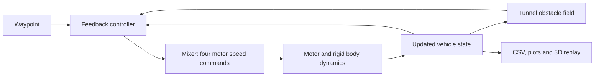

# Quadcopter Exploration

This project is based on the dynamic model and controller designed in [this project](https://github.com/bobzwik/Quadcopter_SimCon), which uses PyDy to derive the equations of motion.

For an explanation of the physics, controller and Python implementation, see [How the model works](#how-the-model-works). The [Python example](#running-and-inspecting-the-model-in-python) shows how to advance the simulation and inspect its state.

## Run the model locally

Use CPython 3.10, 3.11 or 3.12. On Ubuntu/Debian install the matching venv package (for the distribution Python, `sudo apt install python3-venv`). On Linux or macOS, run these commands from the repository root.

```bash
./install_local.sh
./run_local.sh --scenario room --seconds 8 --output build/room.csv --plot build/room.png
./run_local.sh --scenario tunnel --seconds 8 --output build/tunnel.csv
```

On a desktop, add `--view` to either command for an animated 3D replay. The tunnel view follows the quad and draws nearby voxels. Close the window to return to the shell. Matplotlib needs an interactive backend, such as Tk (`sudo apt install python3-tk` on Ubuntu/Debian). The CSV and `--plot` also work over SSH without a display.

The installer creates `.venv` and installs pinned packages. The runner uses that environment and works offline. Set `QUAD_PYTHON=python3.12` before installation to select an interpreter. Output paths are relative to your current directory, so the launcher also works by absolute path from elsewhere. The PNG shows the horizontal track and altitude. Both examples run on a CPU without a display or Isaac Sim.

On Windows PowerShell, use the Python entry point directly.

```powershell
py -3.12 -m venv .venv
.\.venv\Scripts\python.exe -m pip install -r requirements.txt
.\.venv\Scripts\python.exe Simulation\run_local.py --scenario room --seconds 8 --plot build/room.png
```

| Scenario | What to expect |
| --- | --- |
| `room` | The controller climbs to 0.9 m, moves 1.2 m east, then 1.2 m north. At 8 s the position is approximately (1.20, 1.19, 0.90) m. |
| `tunnel` | The original waypoint-following controller and artificial potential field use the bundled voxel cloud. Run for 95 s to reproduce the original simulation duration. The model starts at the tunnel centre height. |

Each model tick is 0.005 s. The CSV includes time zero, every fourth tick, and the final tick. Columns are `time_s,east_m,north_m,up_m,qw,qx,qy,qz`. The unit quaternion rotates a forward-left-up body vector into the east-north-up world. The exporter handles the native frame selected in `Simulation/config.py`. Height is relative to the model origin. The original physical constants remain in `Simulation/quadFiles/initQuad.py`.

The launcher integrates the controller and dynamics on every run. `--plot` saves a still image. Choose `--view` for the Matplotlib 3D window, or follow the VisPy commands below for the OpenGL tunnel.

For an in-process adapter, put this repository root on the Python import path, use `from Simulation.flight import Flight`, construct `Flight("room")`, call `step()` once per model tick, then read `pose()` for a position tuple and a scalar-first quaternion tuple. Construct a new `Flight` to reset. The numerical integration, controller and wind model are shared with `Simulation/run_3D_simulation.py`. Its historical VisPy desktop animation has additional OpenGL and GUI dependencies described below.

This project has as a goal to simulated a quadcopter/quadrotor exploring unknown environments (this is nothing groundbreaking, I'm doing this on my spare time as a hobby and to learn Python).

A pointcloud environment can be generated, where every point of the pointcloud can be considered as an obstacle. Currently, an Artificial Potential Field algorithm is used to navigate through the pointcloud ( each point exerts a force on the drone in order to stop it from colliding with it). More exploration algorithms are to come.

[](https://youtu.be/WuDDGpTPt2g)

## How the model works

The model simulates a rigid quadcopter moving and rotating in three dimensions. Four motors produce thrust and turning moments. The physics calculates how those forces change the vehicle's velocity, position and orientation. A feedback controller reads that state and adjusts the motors to approach a waypoint. In the tunnel scenario, nearby obstacles also influence the controller's desired velocity.

For example, to move horizontally, the controller first tilts the quadcopter. The tilted rotor thrust then has a horizontal component, which accelerates it toward the target. As it approaches the target, the controller reduces the requested velocity and brakes the motion. The resulting path is calculated by integrating the equations of motion on each run.



### Where the Python code lives

Start with `Flight` to see how the components fit together, then follow the controller and dynamics methods.

| File | Responsibility |
| --- | --- |
| [Simulation/flight.py](Simulation/flight.py) | `Flight` constructs a scenario; `step()`, `quad_sim()` and `update_commands()` run the simulation loop. |
| [Simulation/quadFiles/quad.py](Simulation/quadFiles/quad.py) | `Quadcopter` stores the physical state. `state_dot()` evaluates its derivatives; `update()` integrates them. |
| [Simulation/quadFiles/initQuad.py](Simulation/quadFiles/initQuad.py) | Mass, inertia, rotor coefficients, motor response, initial hover state and mixer matrix. |
| [Simulation/trajectory.py](Simulation/trajectory.py), [Simulation/waypoints.py](Simulation/waypoints.py) | Select the desired position and heading from a waypoint sequence. |
| [Simulation/ctrl.py](Simulation/ctrl.py) | `Control` converts position, velocity, orientation and angular rate errors into thrust and moments. Controller gains and limits are near the top. |
| [Simulation/utils/mixer.py](Simulation/utils/mixer.py) | Convert total thrust and three moments into four motor speed commands. |
| [Simulation/potentialField.py](Simulation/potentialField.py) | `PotField` loads obstacle points and calculates their repulsive contribution. |
| [Simulation/config.py](Simulation/config.py), [Simulation/utils/windModel.py](Simulation/utils/windModel.py) | Coordinate convention, optional rotor gyroscopic effects and wind models. |
| [Simulation/run_local.py](Simulation/run_local.py), [Simulation/run_3D_simulation.py](Simulation/run_3D_simulation.py) | Run `Flight`, record poses, and produce output or start a replay. |

### The 21 numbers describing the vehicle

`Quadcopter.state` is a NumPy array containing the variables needed to continue the physical simulation. These are its Python indices; slice endpoints are excluded.

| Indices | Quantity | Units / meaning |
| --- | --- | --- |
| `state[0:3]` | `x, y, z` | Position in the world frame, metres. |
| `state[3:7]` | `q0, q1, q2, q3` | Orientation quaternion, scalar first: `(w, x, y, z)`. |
| `state[7:10]` | `xdot, ydot, zdot` | Velocity in the world frame, m/s. |
| `state[10:13]` | `p, q, r` | Angular velocity about the body's forward, lateral and vertical axes, rad/s. The rate named `q` is separate from the quaternion. |
| `state[13], state[15], state[17], state[19]` | Four rotor speeds | rad/s. |
| `state[14], state[16], state[18], state[20]` | Four rotor speed derivatives | rad/s²; needed for the second order motor response. |

This is six degrees of freedom for the vehicle: three translations and three rotations. The quaternion represents orientation with four numbers constrained to unit length. The additional velocity and motor variables make it possible to calculate how the vehicle evolves. `quad.pos`, `quad.quat`, `quad.vel`, `quad.omega` and `quad.wMotor` expose these values; Euler angles and the rotation matrix are calculated from the quaternion in `extended_state()`.

The default in `config.py` is **NED**: world coordinates are north, east, down, and body axes are forward, right, down. Climbing therefore makes the native `z` negative. The alternative **ENU** setting uses east, north, up and a forward, left, up body. `Flight.pose()` converts the result to ENU position and a quaternion rotating FLU body vectors into ENU world vectors, whichever native convention is selected. The CSV uses this same output convention.

### From motor commands to motion

The controller requests four rotor speeds in rad/s through `ctrl.w_cmd`. Each motor takes time to respond. In `state_dot()`, its speed follows this second order equation:

```text
d²ω/dt² = (kp * command - ω - 2 * damp * tau * dω/dt) / tau²
```

Here `ω` is the rotor speed, `kp` is the motor gain, `damp` is the damping ratio, and `tau` sets the response timescale. Their defaults are `1.0`, `1.0` and `0.015 s`. Storing both `ω` and `dω/dt` turns each second order equation into two first order state equations that SciPy can integrate.

The rotor forces are calculated with the following NumPy operations inside `state_dot()`:

```python
wMotor = np.clip(wMotor, minWmotor, maxWmotor)
thrust = kTh * wMotor * wMotor
torque = kTo * wMotor * wMotor
```

Each rotor's thrust and reaction torque grow with the square of its speed. The default force calculation limits rotor speeds to 75–925 rad/s. With mass `mB = 1.2 kg` and thrust coefficient `kTh = 1.076e-5 N/(rad/s)²`, a level hover requires:

```text
thrust per rotor = mass * gravity / 4 = 2.943 N
hover speed     = sqrt(thrust per rotor / kTh) ≈ 523 rad/s
```

`init_cmd()` calculates this hover speed, and `init_state()` starts all four motors there. A difference between left and right rotor thrust produces roll; a difference between front and rear thrust produces pitch. Alternating rotor reaction torques produce yaw. The motor offsets along the two horizontal body axes are both `0.16 m`.

For the default NED convention, the vehicle equations can be written compactly as:

```text
position derivative = velocity
mass * acceleration = [0, 0, mass * gravity]
                      + R(Q) @ [0, 0, -total_thrust] + drag
I @ angular_acceleration = motor_moments - Ω × (I @ Ω) + gyro_moment
quaternion derivative = 0.5 * Q ⊗ [0, p, q, r]
```

`R(Q)` rotates a body vector into the world frame, `I` is the inertia matrix, `Ω = [p, q, r]` is body angular velocity, `×` is the vector cross product, and `⊗` is quaternion multiplication. These equations explain the expanded component expressions in `DynamicsDot`: gravity and thrust accelerate the vehicle, moments change its angular velocity, and angular velocity changes its orientation. The ENU branch changes the signs appropriate to that convention.

Drag acts separately along each world axis as `-Cd * v_relative * abs(v_relative)`, where `v_relative` is vehicle velocity minus wind velocity. `Flight` selects zero wind by default; drag still opposes vehicle motion. Rotor gyroscopic terms can be enabled with `config.usePrecession`, which defaults to `False`.

### How the controller chooses the motor speeds

Both supplied scenarios use `ctrlType="xyz_pos"`. The controller runs several stages, each producing the target for the next:

1. **Position to velocity.** `xy_pos_control()` and `z_pos_control()` multiply position error by proportional gains and add any trajectory velocity feed-forward. `saturateVel()` limits the resulting speed to `1.5 m/s` by default.
2. **Obstacle adjustment.** In the tunnel, `addFrepToVel()` adds the potential field contribution, then the speed is limited again. This makes nearby obstacles influence the direction of travel. The room scenario disables this contribution.
3. **Velocity to thrust.** `xy_vel_control()` and `z_vel_control()` use velocity error and measured acceleration to request a world-frame thrust vector. A gravity compensation term supplies hover thrust even when the errors are zero. Integral control is available through the parameter spelled `useIntergral`, and is disabled by default. Thrust limits and a default `15°` tilt limit constrain the request.
4. **Thrust to orientation.** `thrustToAttitude()` chooses an orientation that points the rotor thrust in the desired direction while considering the desired yaw. `attitude_control()` uses quaternion error to request body angular rates, limited to `100°/s` per axis.
5. **Angular rates to moments.** `rate_control()` compares desired and actual body rates, with angular acceleration feedback for damping, to calculate roll, pitch and yaw moments.
6. **Moments to motor speeds.** `mixerFM()` uses the inverse of the matrix constructed by `makeMixerFM()` to find squared rotor speeds from `[total_thrust, roll_moment, pitch_moment, yaw_moment]`. It clips those values to the squared motor limits and takes their square roots to obtain `ctrl.w_cmd`.

The room trajectory selects position targets at scheduled times. The tunnel trajectory uses the waypoints in `waypoints.py`, considers a target reached within `0.4 m`, and waits `2 s` before advancing. Its `yawType=4` makes the heading follow the adjusted velocity command.

### How Python advances time

The numerical model has the form `d(state)/dt = state_dot(t, state, cmd, wind)`. The return value of `state_dot()` is another 21-element NumPy array containing rates of change. `Quadcopter.update()` passes that function to SciPy's `ode` integrator, configured with `dopri5`, to calculate the next state.

`Flight` calculates the first command during construction. Each subsequent `Flight.step()` follows this order in `quad_sim()`:

1. Hold the current four motor commands while integrating the dynamics from `t` to `t + DT`.
2. Refresh the position, quaternion, velocity, rotor speeds and derived values. Acceleration estimates for feedback are calculated from the change in velocity and angular velocity over the tick.
3. At the new time, call `Trajectory.desiredState()`, update the obstacle field if enabled, and run `Control.controller()` to prepare commands for the next tick.
4. Increment the tick counter; `flight.time` is the tick count multiplied by `DT`.

The controller interval is fixed at `DT = 0.005 s`, or 200 updates per simulated second. The numerical integrator can take smaller, adaptive steps internally. Simulation time advances through these calculations; it does not depend on sleeping for 5 ms in real time. The runners record poses every fourth tick, or 50 Hz, and include the final tick before plotting or replaying the recording.

### Running and inspecting the model in Python

After installing the dependencies above, run this code from the repository root with the virtual environment's Python, for example by starting `.venv/bin/python` and pasting it:

```python
import numpy as np
from Simulation.flight import DT, Flight

flight = Flight("room")  # Constructs the vehicle, trajectory, controller and wind.

for _ in range(round(8.0 / DT)):
    flight.step()  # Advance physics and update the controller by one model tick.

position, quaternion = flight.pose()
print("Time (s):", flight.time)
print("Position ENU (m):", np.round(position, 3))
print("Body-to-world quaternion (w, x, y, z):", quaternion)
print("Actual rotor speeds (rad/s):", flight.quad.wMotor)
print("Next commanded rotor speeds (rad/s):", flight.ctrl.w_cmd)
```

The final position is approximately `(1.20, 1.19, 0.90) m`. Use `Flight("tunnel")` to include the bundled obstacles and tunnel waypoints. Construct a new `Flight` to restart, so the integrator, trajectory and controller state are all initialized together. For experiments, edit physical constants in `initQuad.py`, controller gains in `ctrl.py`, tunnel waypoints in `waypoints.py`, or the room targets in `flight.py` before constructing the flight.

### Where the equations came from, and what is approximated

The scripts under `PyDy Scripts` derive the vehicle equations symbolically using SymPy mechanics. For example, the [NED quaternion derivation with wind and drag](PyDy%20Scripts/02%20-%20Added%20Wind%20and%20Aero%20Drag/Quad_3D_frd_NED_Quat.py) defines reference frames, motor locations, inertia, forces and torques, then applies `KanesMethod` to form a mass matrix and forcing vector. It solves `MM * state_derivatives = rhs` and prints the derivative expressions. Those expanded expressions are evaluated numerically in `quad.py`, which also adds the motor response states. The local runner uses NumPy and SciPy; it does not run symbolic derivation during a flight.

The controller reads the simulated state directly, so these examples assume ideal state feedback. The tunnel obstacle cloud is loaded in advance; the current model performs local avoidance along predefined waypoints. Sensor measurements, mapping, battery discharge and physical collision/contact response are outside this implementation. Obstacle repulsion changes the controller's request; it is not a contact force in `state_dot()`.


## Pointcloud Generation
There are a few available scripts in this branch to generate simple tunnels. They take a while to execute, since a first create a very fine pointcloud, in order to make sure that once voxelized, there are no gaps between points. By voxelized, I mean that I create a corse Cartesian grid (0.25 m between "voxel" centers) and every point of the fine pointcloud is approximated to its closest "voxel".

## Artificial Potential Field Implementation
In this Artificial Potential Field, there is no **explicit** attractive force, as the flight control already commands a velocity, given a desired position. This velocity command is saturated. The velocity control then computes a desired thrust/force, which in turn indicates the desired quadrotor attitude (orientation) ([See 'master' readme and PX4 controller](https://github.com/bobzwik/Quadcopter_SimCon/tree/master))

The repulsive force is calculated using a widely used algorithm (see **Siegwart's Introduction to Autonomous Mobile Robots**). Every point of the voxelized pointcloud is considered an object. This force is then implemented into the controller through 3 different possible ways.

1. Added to the saturated "attractive" velocity. The resulting desired velocity is then saturated again (to prevent large velocity commands).

2. Added to the desired thrust/force, which is then saturated (to prevent large force commands). The saturation is defined using a specified maximum tilt of the quadrotor.

3.  Added to the desired thrust/force after its saturation.

Currently, method # 1 is used, and the repulsive gain is set accordingly.

In [potentialField.py](Simulation/potentialField.py), `isWithinRange()` first selects points inside a box extending `2.5 m` along each axis from the quadcopter. `isWithinField()` keeps those within a spherical radius of `2 m`. For each selected obstacle at position `o`, the base contribution is:

```text
d = distance from the quadcopter to o
repulsion = 0.4 * (1/d - 1/2) / d² * (quad.pos - o) / d
```

The last factor is a unit vector pointing away from the obstacle. The contribution grows as the distance decreases and reaches zero at the field boundary. When the target direction is defined, the code also weights each contribution by `cos(angle)²`, where `angle` is between the obstacle direction and the target direction. This gives points along either direction of the target axis more influence than points to the side. The contributions are summed into `F_rep`; with method #1, this value acts as a velocity adjustment in the controller. The position feedback already supplies motion toward the waypoint.


### Useful links
* [Youtube video on Artificial Potential Field](https://youtu.be/8Vva0bnMIEI)
* [Slides on Artificial Potential Field](https://www.cs.cmu.edu/~motionplanning/lecture/Chap4-Potential-Field_howie.pdf)
* [More slides](https://www.dis.uniroma1.it/~oriolo/amr/slides/MotionPlanning3_Slides.pdf)
* A pdf of Siegwart's book can easily be found online ;)


## Visualization Using VisPy

Install the optional OpenGL viewer once from the fork root. Run the following on the computer with your display.

```bash
./install_local.sh --vispy
./run_local.sh --vispy --seconds 20 --no-plots
```

The runner first integrates the tunnel flight, reports progress, then opens an interactive VisPy window and plays the recorded poses in real time. Drag with the left mouse button to orbit the drone and scroll to zoom. Yellow cubes show obstacles, red cubes mark those inside the potential field, green points mark waypoints, red/blue arms show the drone, and a line traces its path. The camera follows the drone. The final pose stays on screen until you press **Esc** or close the window.

```bash
# Use point markers to draw the same tunnel
./run_local.sh --vispy --seconds 20 --renderer markers --no-plots
# Original 95-second flight, with diagnostic figures after you close the window
./run_local.sh --vispy
# Direct Python entry point, also supported
.venv/bin/python Simulation/run_3D_simulation.py --seconds 20 --renderer boxes --no-plots
```

On Windows, after creating the virtual environment above, run:

```powershell
.\.venv\Scripts\python.exe -m pip install -r requirements-vispy.txt
.\.venv\Scripts\python.exe Simulation\run_3D_simulation.py --seconds 20 --no-plots
```

Use `--renderer boxes` for cubes with perspective depth, or `--renderer markers` for lighter fixed-size points. Omit `--no-plots` to inspect the original Matplotlib diagnostics after playback. This entry always uses the original tunnel. To see the room, use `./run_local.sh --scenario room --seconds 8 --view`. The VisPy viewer requires a desktop session and an OpenGL driver usable by GLFW. [VisPy installation](https://vispy.org/installation.html)

## To-Do
* Implement "Extended Potential Field" to reduce oscillations
* Implement "Frontier Based Exploration" (so learn about ray-casting and possibly octomaps)
* Implement some king of "Path Planning"
* Use the `multiprocessing` Python package to parallelize different tasks (a process for the quadcopter dynamics, one for the control, one for the "Frontier Based Exploration" and one for the visualization)
